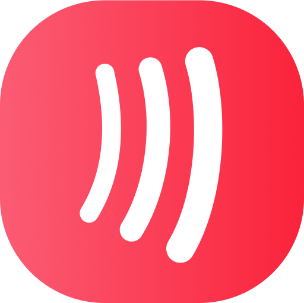
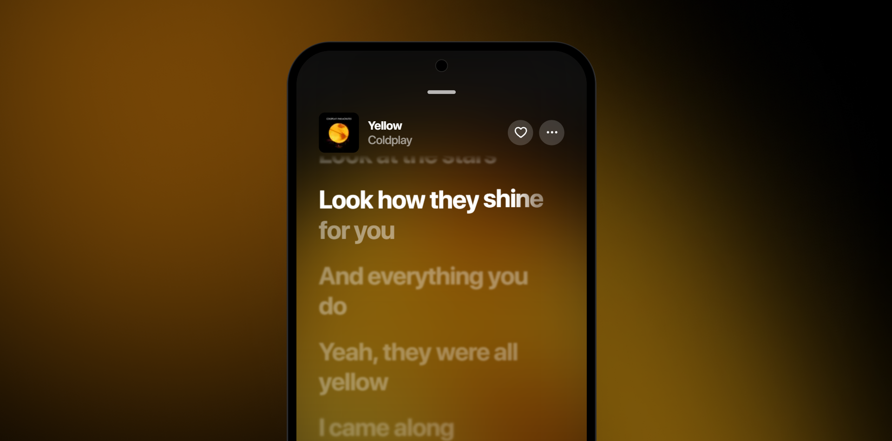

  <div align="center">

  <br/>
  <br/>

  

  # AfterTone

  ### Aesthetic Native YouTube Music made in RUST

  <br/>

  
  [](https://github.com/arzeck/AfterTone/releases)
  [](https://github.com/arzeck/AfterTone/blob/main/LICENSE)

  <br/>

  <a href="https://github.com/arzeck/AfterTone/releases" target="_blank" rel="noopener noreferrer"></a>

  <br/>

  [**Download**](#download) · [**Features**](#features) · [**CLI & Development**](#cli--development) · [**Contributing**](#contributing) · [**Credits**](#credits) · [**Disclaimer**](#disclaimer)

  </div>

  > [!IMPORTANT]
  > AfterTone is not affiliated with, endorsed by, or connected to YouTube or Google in any way. Use it at your own discretion.

  ---

  <div align="center">

  

  <h1><a id="features"></a>Features</h1>

  <table>
    <tr>
      <td width="50%" valign="top">

  #### Playback & Audio
  - **Search, browse and play** anything available on YouTube Music.
  - **Hi-Res 320kbps audio upgrade** with pure Rust DES-ECB decryption and in-memory TTL caching.
  - **HTTP 206 Partial Content Proxy** — ultra-fast scrubbing, seeking, and zero-latency streaming.
  - **Gapless playback with true crossfade**, adjustable 0–12s.
  - **Automix [Beta]** — DJ-style transitions with beat-matching and tempo-stretching.
  - **Offline downloads** — save tracks with embedded metadata.
  - **Local music library** scanner and integration.
  - **Windows SMTC & Media Keys** — native Windows 11 transport flyout and hardware key controls.

  #### Synchronization & Party
  - **Listen Together Wire Protocol** — real-time shared playback (`PartyTrack`, `PartyMember`, `PartyPlayback`, `PartyQueue`).
  - **6-character party codes** with base32 validation and ambiguity mapping (`I`/`L` &rarr; `1`, `O` &rarr; `0`).
  - **Monotonic Server Clock (NTP)** — zero-drift playhead sync with sliding-window jitter filtering.
  - **Local Wi-Fi party server** built directly into the engine.

      </td>
      <td width="50%" valign="top">

  #### Experience & Lyrics
  - **Apple Music-fidelity lyrics animation** — word-by-word progressive karaoke reveal, syllable easing, and fluid spring scrolling powered by [am-lyrics](https://github.com/binimum/am-lyrics).
  - **Multi-provider lyrics racing** — parallel queries across [lrc.red](https://lrc.red), [BiniLyrics](https://github.com/binimum), [BetterLyrics](https://github.com/better-lyrics/better-lyrics), [SimpMusic](https://github.com/maxrave-dev/SimpMusic), and [LRCLIB](https://lrclib.net).
  - **Apple Music TTML parser** — supports syllable timestamps, background vocals, romanization, translations, and multi-vocalist duet alignments.
  - **Frosted-glass UI** — translucent bars, Material 3 theming, and dynamic artwork-driven palettes.

  #### Controls & Connectivity
  - **Sign in with your Google account** for personalized library and recommendations.
  - **Spotify integration** — connect your account to play your playlists and Liked Songs.
  - **Discord Rich Presence** — live track, artist, album, and timeline status.
  - **Scrobbling** to Last.fm and ListenBrainz.
  - **Stats for nerds** — codec, bit depth, sample rate, and real-time buffer metrics.

      </td>
    </tr>
  </table>

  </div>

  ---

  <div align="center">

  <h1><a id="download"></a>Download</h1>

  <a href="https://github.com/arzeck/AfterTone/releases" target="_blank" rel="noopener noreferrer"></a>


  ### Windows Installer
  Grab the standalone Windows Setup executable (**`AfterTone-Setup-v1.0.0.exe`**) from the [Releases](https://github.com/arzeck/AfterTone/releases) page.
  - **One-click installation** into `%LOCALAPPDATA%\Programs\AfterTone` (zero UAC / admin prompts required).
  - Includes bundled JRE 21 runtime and Compose Desktop Skiko binaries.
  - Automatically creates Start Menu and optional Desktop shortcuts.
  - Fully registered in Windows Settings &rarr; Installed Apps for clean uninstallation.

  </div>

  ---

  <div align="center">

  <h1><a id="cli--development"></a>CLI & Development</h1>

  </div>

  AfterTone includes a native high-performance Rust engine and CLI utility:

  ```bash
  # 1. Launch the native desktop player
  aftertone

  # 2. Host a local Listen Together party room
  aftertone serve --port 8000

  # 3. Join a party room from terminal with live karaoke UI
  aftertone join 7A9K2M --tui

  # 4. Create a new party room
  aftertone create --name "My Room" --tui

  # 5. Concurrent lyrics race across all providers
  aftertone lyrics --title "Blinding Lights" --artist "The Weeknd"

  # 6. Resolve 320kbps audio stream URL
  aftertone stream --title "Shape of You" --artist "Ed Sheeran"

  # 7. Start audio range proxy server
  aftertone proxy
  ```

  ### Repository Structure

  AfterTone is organized as a clean multi-platform monorepo:

  ```text
  AfterTone/
  ├── .github/        CI workflows and automated test pipelines
  ├── engine/         Native Rust backend engine, proxy, and CLI utility
  ├── windows/        Windows desktop app, installer configuration, and build scripts
  ├── web/            Web client and party listen-along interface
  ├── docs/           Documentation, technical specifications, and development plans
  ├── Banner.png      Repository branding banner
  ├── Logo.png        Application icon artwork
  ├── README.md       Project documentation and guides
  ├── LICENSE         GNU General Public License v3.0
  └── .gitignore      Project and platform ignore definitions
  ```

  ### Building From Source

  ```bash
  # Run unit and integration tests (16 tests)
  cargo test --manifest-path engine/Cargo.toml
  # or from the engine directory:
  cd engine && cargo test

  # Build optimized release executable
  cargo build --release --manifest-path engine/Cargo.toml
  # or from the engine directory:
  cd engine && cargo build --release

  # Compile the standalone Windows Setup installer
  powershell -ExecutionPolicy Bypass -File windows\scripts\build-installer.ps1
  ```

  ---

  <div align="center">

  <h1><a id="credits"></a>Credits & Upstream Attribution</h1>

  </div>

  - **BitChord** ([kushagrasinghx/BitChord](https://github.com/kushagrasinghx/BitChord)): Credit to Kushagra Singh and the BitChord project for the Listen Together synchronization protocol inspiration, jam invite link schemas, and desktop player architecture.
  - **am-lyrics** ([binimum/am-lyrics](https://github.com/binimum/am-lyrics)): Credit to Max Bai (`binimum`) for the Apple Music-fidelity web component and word-by-word synchronized lyrics rendering engine.
  - **Lyrics Providers**: Thanks to [lrc.red](https://lrc.red), [BiniLyrics](https://github.com/binimum), [BetterLyrics](https://github.com/better-lyrics/better-lyrics), [SimpMusic](https://github.com/maxrave-dev/SimpMusic), and [LRCLIB](https://lrclib.net) for community lyrics APIs.

  ---

  <div align="center">

  <h1><a id="contributing"></a>Contributing</h1>

  We welcome contributions to AfterTone! Please review our [Contributing Guide](CONTRIBUTING.md) and [Code of Conduct](CODE_OF_CONDUCT.md) before submitting a Pull Request.

  [**Contributing Guide**](CONTRIBUTING.md) · [**Code of Conduct**](CODE_OF_CONDUCT.md)

  </div>

  ---

  <div align="center">

  <h1><a id="disclaimer"></a>Disclaimer & Legal Notice</h1>

  AfterTone is an independent, community-driven third-party audio player and client. It is **not** associated with Google LLC, YouTube Music, or any of their parent companies.

  * **No Media Hosting:** AfterTone does not host, upload, or store copyrighted music files. It operates strictly as an interface to scan local device storage or stream media directly from public, public-facing, or user-authenticated APIs.
  * **Fair Use & API Usage:** This software is created solely for personal research, educational, and fair-use purposes. The user is entirely responsible for ensuring their usage aligns with their local copyright laws and YouTube Terms of Service.
  * **Copyleft:** AfterTone is free software under the GPLv3.

  </div>

  ---

  <div align="center">

  <h1><a id="license"></a>License</h1>

  This project is licensed under the **GNU General Public License v3.0 (GPLv3)**. See the [LICENSE](LICENSE) file for details.

  </div>
